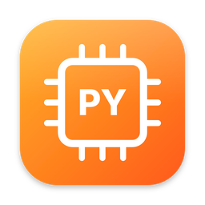

<p align="center"></p>

# PY-Sys — pemantau, pembersih & utilitas Mac di menu bar

PY-Sys adalah aplikasi menu bar untuk **semua Mac dengan RAM berapa pun** (8, 16, 24 GB atau lebih), Apple Silicon maupun Intel, macOS 13 Ventura atau lebih baru. Manfaatnya paling terasa di Mac 8 GB yang dipakai untuk banyak tab browser, beberapa monitor, dan agen AI, tetapi Mac dengan RAM besar juga terbantu untuk tetap rapi, terpantau, dan produktif.

Semua fitur memakai API publik macOS: tanpa root, tanpa mematikan SIP, dan tidak mengubah file sistem.

**[⬇︎ Unduh versi terbaru (DMG)](../../releases/latest)**

## Fitur

### Monitoring
| Fitur | Isi |
| --- | --- |
| Dashboard | CPU, GPU, disk, RAM, kipas, dan internet dalam satu layar |
| RAM | Tekanan memori, komposisi (App/Wired/Terkompresi/Cache), swap, page-in/out, grafik 10 menit |
| CPU & GPU | Beban per inti (P/E di Apple Silicon), suhu, GPU, load average, proses teratas |
| Jaringan & Sensor | Kecepatan, antarmuka, IP publik; suhu, kipas, daya, baterai |
| Agen AI | Claude Code, Codex, Gemini, Ollama, MLX, Node/Python: RAM, CPU, jeda/hentikan, peringatan macet |
| Browser | RAM per browser dirinci tab, ekstensi, GPU; jumlah tab |
| Riwayat | Grafik 24 jam/7 hari, tulis SSD per hari, perkiraan umur SSD, saran restart |

### Cleaner
| Fitur | Isi |
| --- | --- |
| Aplikasi & Cryo-Sleep | RAM per aplikasi; membekukan app idle yang tidak terlihat dan mencairkannya saat dibuka |
| Mode fokus | Profil kerja yang membekukan app di luar profil dengan satu klik |
| Tab browser | Simpan & tutup tab, tutup duplikat, buka lagi kapan saja |
| Penyimpanan | Cache, log, cache developer, Sampah, unduhan lama |
| Uninstaller | Hapus aplikasi beserta file sisanya di ~/Library |
| File besar & duplikat | Temukan file besar dan salinan identik |

### Utility
| Fitur | Isi |
| --- | --- |
| Toggle cepat | Tutup semua app, tetap terjaga, kunci layar, Dark Mode, Dock, dan lainnya |
| Klik Kanan+ | Menu Finder tambahan: file baru, salin path, pindah ke, warna folder |
| Jendela | Snap jendela dengan ⌃⌥, pindah monitor, simpan tata letak multi-monitor |
| Clipboard | Riwayat salin dengan ⌃⌥V |
| Monitor | Kecerahan DDC dan peredup software untuk semua layar |
| Jadwal | Tugas perawatan otomatis pada jam tertentu |
| Scroll Reverser | Arah scroll terpisah untuk trackpad dan mouse |
| Alat | Info sistem, kesehatan baterai, ekspor laporan PDF |

Juga: dua bahasa (Indonesia/English), tema, widget menu bar, dan pembaruan otomatis dari GitHub Releases.

## Memasang

1. Unduh **PY-Sys-x.y.z.dmg** dari [Releases](../../releases/latest).
2. Buka DMG, seret **PY-Sys** ke **Applications**, lalu buka.
3. (Opsional) Cek keaslian: `shasum -a 256 ~/Downloads/PY-Sys-x.y.z.dmg` harus sama dengan kode SHA-256 di halaman rilis.
4. Bila muncul peringatan "pengembang tidak dikenal": **System Settings → Privacy & Security → Open Anyway**.
5. Untuk Jendela, Clipboard, Klik Kanan+, dan Scroll Reverser: izinkan PY-Sys di **Privacy & Security → Accessibility**.
6. Pembaruan otomatis: **Utility → Pengaturan → Pembaruan**, isi nama repo ini (`pemilik/PY-Sys`).

## Build dari kode

Butuh Command Line Tools (`xcode-select --install`), tidak perlu Xcode lengkap.

```bash
./make-cert.sh        # sekali saja: sertifikat lokal agar izin macOS tidak hilang tiap build
./build.sh --install  # build universal (arm64 + x86_64) dan pasang di /Applications
./build.sh --dmg      # buat build/PY-Sys-<versi>.dmg
./build.sh --all      # keduanya
./release.sh "catatan" # build DMG, push, dan buat GitHub Release
```

---

## English

PY-Sys is a menu bar app that monitors, cleans and looks after **any Mac, whatever its RAM** (8, 16, 24 GB or more), on Apple Silicon or Intel with macOS 13 Ventura or later. It helps most on 8 GB Macs running many browser tabs, several displays and AI agents, and keeps larger Macs tidy and well monitored too. It uses only public macOS APIs: no root, no SIP changes, no system files modified.

Download the latest DMG from [Releases](../../releases/latest), drag PY-Sys to Applications, and allow it under Privacy & Security if macOS warns about an unidentified developer.

© 2026 Periyadi · periyadi@telkomuniversity.ac.id
